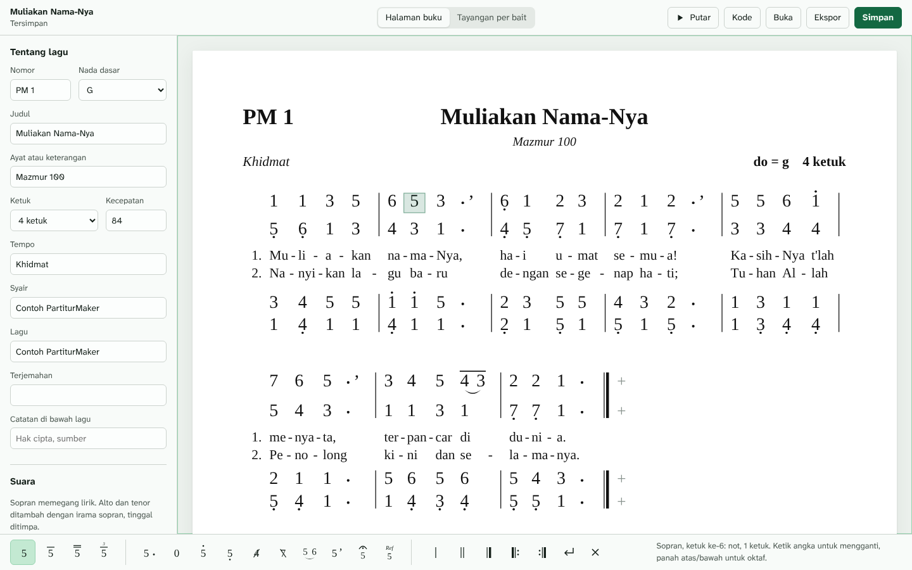

# PartiturMaker

Aplikasi Windows untuk menulis partitur **not angka** gaya Kidung Jemaat, PKJ dan NKB.
Tulis langsung di halaman partitur: klik sebuah not, ketik angkanya, isi liriknya di
bawahnya. Di balik layar setiap suntingan menjadi kode **Nada**, bahasa teks kecil yang
bisa dibaca, dirapikan, dan disimpan sebagai berkas `.nada`.



## Yang bisa dilakukan

- **Menulis di partitur.** Klik not lalu ketik `1` sampai `7`. Panah atas/bawah untuk
  oktaf, `[` dan `]` untuk panjang not, `#` dan `b` untuk kres dan mol, `s` untuk legato,
  `;` untuk tanda napas, `|` untuk garis birama. Palet di bawah menyediakan semuanya untuk
  tetikus.
- **Lirik di tempatnya.** Klik dua kali sebuah not, ketik suku kata, tekan spasi untuk
  pindah ke not berikutnya atau `-` untuk menyambung kata.
- **Judul dan keterangan di tempatnya.** Klik judul, nomor, tempo atau nama pencipta di
  halaman untuk mengubahnya, atau isi lewat panel kiri.
- **Empat suara.** Tambah alto, tenor, bas; suara baru langsung mengikuti irama sopran.
- **Gaya buku nyanyian.** Garis harga di atas angka, titik oktaf, legato melengkung di
  bawah angka, kres bergaris miring, tanda napas, fermata, tanda ulang, `do = f   4 ketuk`,
  pencipta di bawah lagu, bait tambahan sebagai teks.
- **Tayangan per bait.** Satu set slide 16:9 untuk setiap bait, siap untuk proyektor.
- **Kode Nada.** Panel kode menampilkan lagu sebagai teks, lengkap dengan nomor baris,
  pesan kesalahan berbahasa Indonesia dan tombol **Rapikan**.
- **Ekspor** PDF (font tertanam), PNG 300 dpi, SVG, atau cetak langsung. Kertas A4,
  F4, Letter, A5.
- **Putar** semua suara dengan sorotan not yang sedang berbunyi.

Panduan lengkap bahasanya ada di [docs/bahasa-nada.md](docs/bahasa-nada.md).

## Unduh

Installer dibangun otomatis oleh GitHub Actions:

1. Buka tab **Actions**, pilih workflow **Build**, lalu proses terbaru.
2. Unduh artefak **PartiturMaker-Windows** dan ekstrak.
3. Jalankan `PartiturMaker_2.0.0_x64-setup.exe` (atau berkas `.msi`).

Untuk rilis resmi: push tag `v2.0.0`, jalankan workflow Build secara manual dengan input tag, atau push commit yang pesannya memuat `[rilis]`. Installer akan dilampirkan ke Releases.
Aplikasi belum ditandatangani, jadi Windows SmartScreen bisa menampilkan peringatan.
Pilih **More info**, lalu **Run anyway**.

## Susunan kode

| Bagian | Isi |
|---|---|
| `crates/notangka` | Inti Rust: parser, formatter, operasi sunting, tata letak, SVG, PDF |
| `crates/notangka-wasm` | Jembatan WebAssembly untuk antarmuka |
| `ui/` | Antarmuka editor (HTML, CSS, JavaScript tanpa framework) |
| `src-tauri/` | Aplikasi desktop Tauri: dialog buka dan simpan berkas |

Alurnya: teks `.nada` → `parse` → model lagu → `layout` → SVG atau PDF. Editor memanggil
`edit::apply` untuk setiap suntingan, lalu `format` menulis ulang kodenya.

## Mengembangkan

Butuh Rust (stable) dengan target `wasm32-unknown-unknown`, dan Node.js 20 atau lebih baru.

```bash
rustup target add wasm32-unknown-unknown
```

```bash
npm install
```

Jalankan tes inti:

```bash
cargo test -p notangka
```

Coba antarmuka di browser (http://localhost:8765):

```bash
npm run web
```

Jalankan sebagai aplikasi desktop:

```bash
npm run dev
```

Bangun installer (di Windows):

```bash
npm run build
```

Rapikan berkas `.nada` dari terminal:

```bash
cargo run -p notangka --example nadafmt -- lagu.nada
```

## Font

- Partitur: Liberation Serif (SIL Open Font License 1.1), ukurannya sama dengan
  Times New Roman, sehingga tampilan layar, PNG dan PDF sama persis.
- Antarmuka: Atkinson Hyperlegible Next (SIL Open Font License 1.1).

## Hak cipta lagu

Contoh lagu bawaan dibuat khusus untuk aplikasi ini. Syair dan lagu di KJ, PKJ, NKB dan
buku sejenis umumnya dilindungi hak cipta (misalnya milik YAMUGER). Pastikan Anda punya
izin sebelum memperbanyak atau membagikannya.
